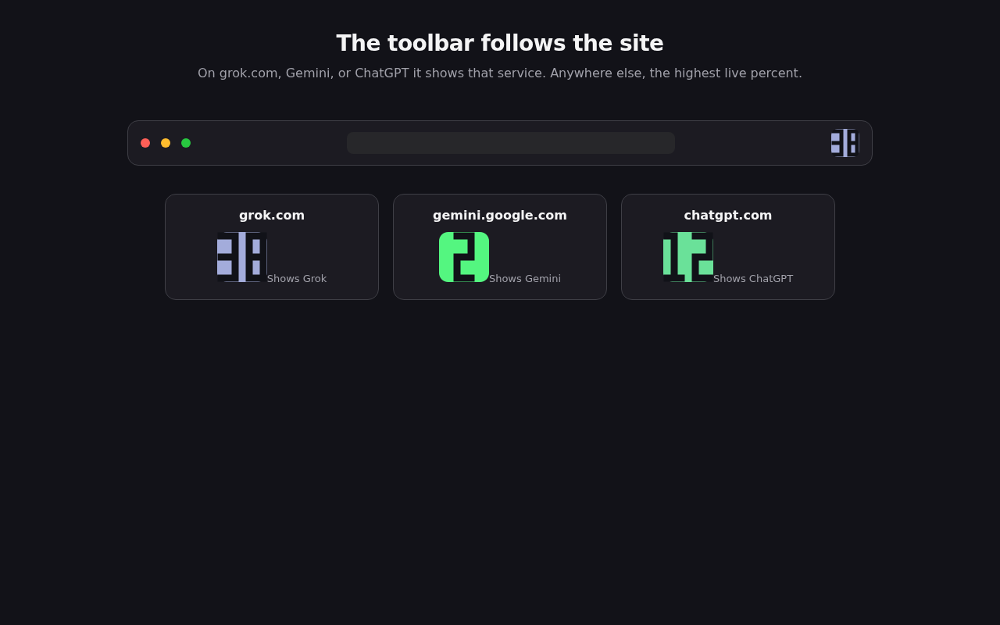
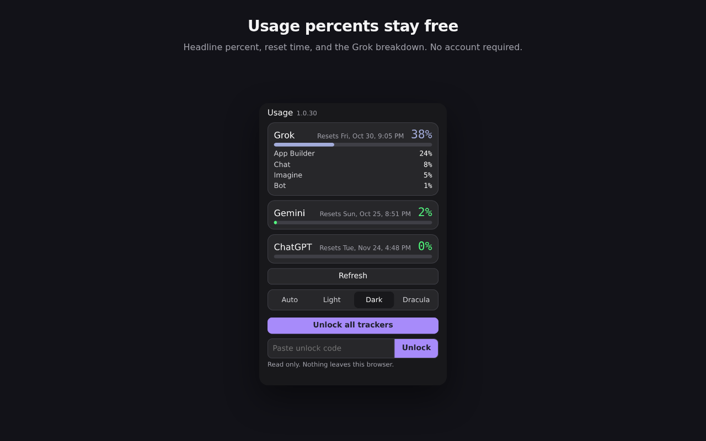
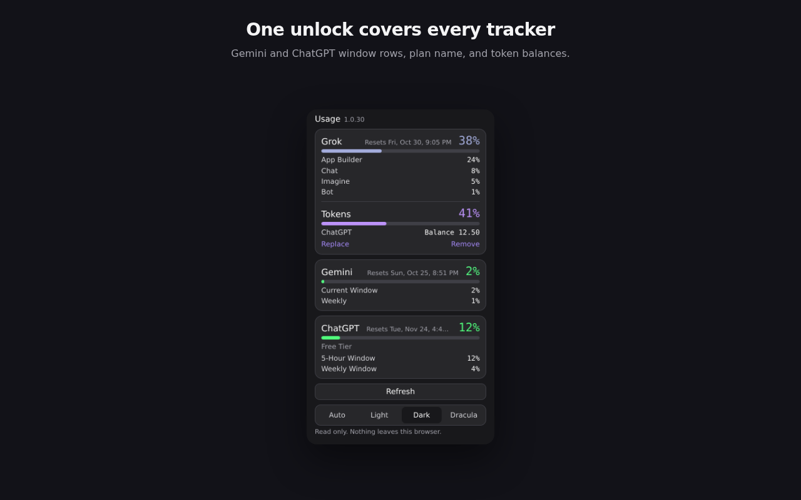
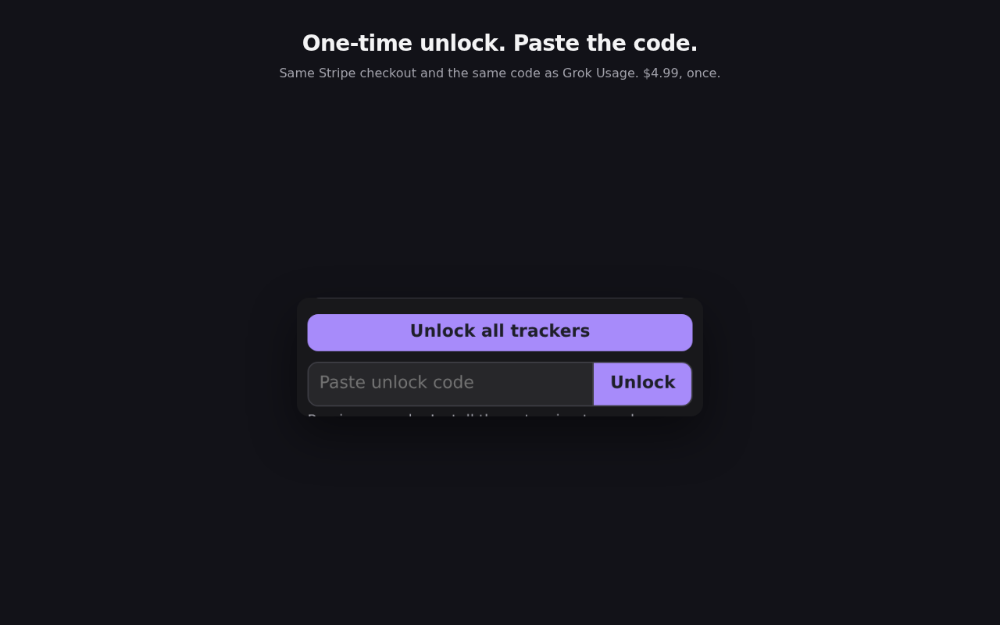
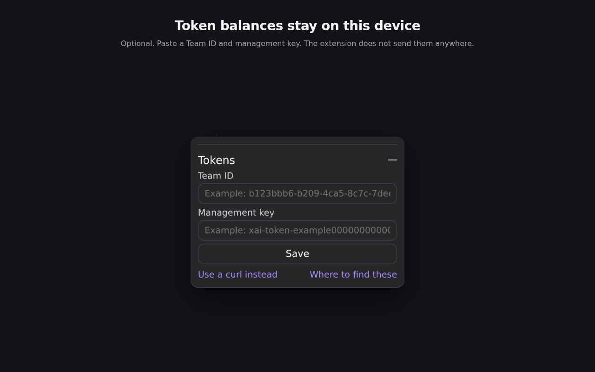

  

<h1 align="center">Master AI Usage</h1>

  One toolbar percentage for Grok, Gemini, and ChatGPT. 
  Reads each site's own usage and never invents a number.

  <a href="https://addons.mozilla.org/en-US/firefox/addon/master-ai-usage/"><strong>Get it for Firefox</strong></a>

  
  

---

## Screenshots

### The toolbar follows the site

On grok.com, Gemini, or ChatGPT it shows that service. Anywhere else, the highest live percentage.

  

### Usage percentages stay free

Headline percentage, reset time, and the Grok breakdown. No account required.

  

### One unlock covers every tracker

Gemini and ChatGPT window rows, the plan name, and token balances.

  

### One-time unlock

Buy with Apple Pay, Google Pay, or card, or paste a code. A Grok Usage code works here. $4.99, once.

  

### Token balances stay on this device

Optional. Paste a Team ID and management key. They stay on this device and are not sent anywhere.

  

---

## What it does

The tile follows the site in the active tab: grok.com, gemini.google.com, or chatgpt.com. Anywhere else it shows the highest live usage among signed-in services.

Each service is an adapter that returns `{ percent, resetsAt, products, note }`. If a site does not expose a number, the popup says "Signed in, usage not exposed". It never invents a percent.

Usage percentages stay free. Token balances and the extra window rows are a one-time $4.99 unlock, the same Stripe payment and the same unlock code as Grok Usage. A code from either extension works in both.

## Install

- Firefox: install from [Mozilla Add-ons](https://addons.mozilla.org/en-US/firefox/addon/master-ai-usage/)
- Firefox: `master-ai-usage-1.0.30-firefox.xpi`
- Chrome: `master-ai-usage-1.0.30-chrome.zip`

Windows and Linux use the same packages.

Firefox: Add-ons and themes → gear → Install Add-on From File → choose the xpi.

Chrome: unzip, open `chrome://extensions`, turn on Developer mode, Load unpacked, choose the folder.

## Privacy

Data stays in the browser. The extension reads the signed-in session on each site and does not send it anywhere else.
